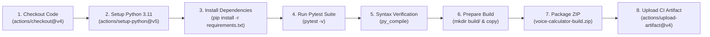

# VoiceCalc Pro — Voice-Controlled Calculator with DevOps CI Pipeline

[](https://github.com/YOUR_GITHUB_USERNAME/voice-calculator/actions/workflows/ci.yml)
[](https://www.python.org/)
[](https://docs.pytest.org/)
[](LICENSE)
[](#devops-practicum-walkthrough)

A modern, responsive, voice-enabled web calculator coupled with a complete Continuous Integration (CI) pipeline using **GitHub Actions**, built for Software Engineering and DevOps practicums.

Users can speak naturally using the browser's native **Web Speech API**, listen to results via the **SpeechSynthesis API**, calculate complex arithmetic and scientific equations with an elegant glassmorphic interface, and verify mathematical logic through automated **pytest** test suites.

---

## Table of Contents

- [Project Objectives](#project-objectives)
- [Key Features](#key-features)
- [Technology Stack](#technology-stack)
- [Project Architecture & Directory Structure](#project-architecture--directory-structure)
- [Local Installation & Setup](#local-installation--setup)
- [How to Run the Application](#how-to-run-the-application)
- [Automated Testing with pytest](#automated-testing-with-pytest)
- [GitHub Actions CI Pipeline Breakdown](#github-actions-ci-pipeline-breakdown)
- [DevOps Practicum Walkthrough (Git & GitHub Guide)](#devops-practicum-walkthrough)
- [Practicum Report Screenshot Checklist](#practicum-report-screenshot-checklist)
- [Viva Voce Questions & Answers](#viva-voce-questions--answers)
- [Future Enhancements](#future-enhancements)

---

## Project Objectives

1. **Software Engineering**:
   - Deliver an intuitive, accessible, and responsive user experience.
   - Separate concerns cleanly: Presentation layer (HTML/CSS), Client Logic & NLP (JavaScript), and Core Math Logic with type safety (Python).
   - Eliminate dangerous execution functions (zero `eval()` usage) using deterministic AST/token-based evaluation.
2. **DevOps Engineering**:
   - Implement source code management best practices via **Git** branching and commit hygiene.
   - Enforce **Continuous Integration (CI)** through **GitHub Actions** workflows triggered on every push and pull request.
   - Automate unit testing and static syntax checking (`py_compile`) as strict quality gates.
   - Automate distribution build creation and upload packaged release ZIP artifacts.

---

## Key Features

- **🎙️ Natural Voice Input (Web Speech API)**:
  - Speak calculations naturally without needing API keys or paid services.
  - Examples supported:
    - *"What is 25 plus 40?"* $\rightarrow 65$
    - *"Multiply 12 by 8"* $\rightarrow 96$
    - *"Divide 100 by 4"* $\rightarrow 25$
    - *"What is 15 percent of 200?"* $\rightarrow 30$
    - *"What is the square root of 144?"* $\rightarrow 12$
    - *"2 to the power of 8"* $\rightarrow 256$
    - *"Sine of 30"* $\rightarrow 0.5$
  - Active audio waveform visualizer and glowing pulse animation while listening.
- **🔊 Voice Output Feedback (SpeechSynthesis API)**:
  - Speaks the answer back aloud with natural intonation.
  - One-click mute/unmute toggle with setting persistence.
- **🎨 Glassmorphic Premium UI/UX**:
  - Dark mode by default with radial ambient glow and frosted glass aesthetic.
  - Light/Dark theme toggle with automatic `localStorage` preference memory.
  - Responsive layout optimized for mobile screens, tablets, and desktop workstations.
- **🧮 Standard & Scientific Capabilities**:
  - Standard arithmetic: Addition ($+$), Subtraction ($-$), Multiplication ($\times$), Division ($\div$).
  - Scientific functions: Square root ($\sqrt{x}$), Square ($x^2$), Exponentiation ($x^y$), Percentage ($\%$) and Trigonometric functions ($\sin$, $\cos$, $\tan$).
- **📜 Calculation History Drawer**:
  - Records every calculation with timestamps and voice indicators.
  - Click any entry to restore the value directly into the calculator display.
  - Persistent across page reloads via `localStorage`.
- **⌨️ Keyboard Navigation**:
  - Full numeric keypad support (`0-9`, `.`, `+`, `-`, `*`, `/`, `^`, `%`, `Enter`, `Backspace`, `Escape`).
  - Spacebar shortcut to activate the voice microphone instantly.
- **🛡️ Strict Error Handling**:
  - Graceful handling of division by zero, negative square roots, undefined trigonometric values, and unparseable voice queries.

---

## Technology Stack

| Domain | Technology | Purpose |
|---|---|---|
| **Frontend UI** | HTML5 / CSS3 | Modern glassmorphic semantic layout with CSS variables & responsive grid |
| **Client Scripting** | JavaScript (ES6+) | Safe math parser (Shunting-yard algorithm), event handling, history store |
| **Voice Recognition** | Web Speech API (`SpeechRecognition`) | In-browser speech-to-text without external API fees |
| **Voice Synthesis** | Web Speech API (`SpeechSynthesis`) | In-browser text-to-speech for audible answers |
| **Backend & Logic** | Python 3.10+ | Clean mathematical core module (`calculator.py`) without `eval()` |
| **Automated Testing** | pytest 8+ | Comprehensive 33+ unit tests verifying calculations and edge cases |
| **Version Control** | Git | Distributed source code management |
| **Repository Hosting** | GitHub | Cloud repository with issue tracking and collaboration |
| **Continuous Integration** | GitHub Actions | Automated build, test, syntax verification, and artifact deployment |

---

## Project Architecture & Directory Structure

```text
voice-calculator/
├── .github/
│   └── workflows/
│       └── ci.yml             # GitHub Actions CI workflow configuration
├── tests/
│   └── test_calculator.py     # 33+ automated pytest test cases
├── .gitignore                 # Files excluded from Git version control
├── calculator.py              # Modular Python mathematical engine (no eval)
├── index.html                 # Semantic HTML5 frontend interface
├── style.css                  # Glassmorphic responsive styling & theme variables
├── script.js                  # Speech API, safe parser & UI state logic
├── pytest.ini                 # Pytest runner configuration
├── requirements.txt           # Python dependency specification
└── README.md                  # Comprehensive documentation and viva guide
```

---

## Local Installation & Setup

### 1. Prerequisites
Ensure you have the following installed on your machine:
- **Python 3.10 or higher**: [Download Python](https://www.python.org/downloads/)
- **Git**: [Download Git](https://git-scm.com/)
- A modern web browser with microphone access (Google Chrome, Microsoft Edge, or Safari recommended for Web Speech API).

### 2. Clone or Navigate to the Project Folder
```bash
cd c:\Users\LENOVO\Desktop\calculatorSE
```

### 3. Create and Activate a Python Virtual Environment (Recommended)
- **On Windows (PowerShell)**:
  ```powershell
  python -m venv venv
  .\venv\Scripts\Activate.ps1
  ```
- **On Linux / macOS**:
  ```bash
  python3 -m venv venv
  source venv/bin/activate
  ```

### 4. Install Dependencies
```bash
pip install -r requirements.txt
```

---

## How to Run the Application

### Option A: Local Python HTTP Server (Recommended for Voice Features)
The browser Web Speech API works best over `http://localhost` or `https://` protocols:

```bash
python -m http.server 8000
```
Then open your browser and navigate to:
```
http://localhost:8000
```

> **Note on Microphone Permission**: When prompted by Google Chrome or Edge, click **"Allow"** to grant microphone access.

### Option B: Direct File Opening
You can double-click `index.html` or open it directly in your browser. (Note: standard calculator functions work, but some browsers restrict microphone access on `file:///` URLs due to browser security policies).

---

## Automated Testing with pytest

The test suite in [`tests/test_calculator.py`](file:///c:/Users/LENOVO/Desktop/calculatorSE/tests/test_calculator.py) covers 33 unit test cases verifying:
- Positive, negative, zero, and floating-point addition
- Positive, negative, and zero subtraction
- Basic, negative, and fractional multiplication
- Division and float accuracy
- Division by zero exception handling (`ZeroDivisionError`)
- Percentage operations ($15\%$ of $200 = 30$)
- Exponentiation ($2^8 = 256$, zero exponents, negative exponents)
- Square and square root calculations
- Negative square root exception handling (`ValueError`)
- Trigonometric functions ($\sin 30^\circ$, $\cos 60^\circ$, $\tan 45^\circ$)
- Undefined tangent exception handling
- Strict type checking (rejecting strings, `None`, booleans, `NaN`, `Infinity`)
- Safe simple expression evaluation

### Execute Tests
Run pytest with verbose output:
```bash
pytest -v
```

Expected output:
```text
tests/test_calculator.py::test_addition_positive_integers PASSED
tests/test_calculator.py::test_addition_negative_numbers PASSED
tests/test_calculator.py::test_division_by_zero_raises_exception PASSED
tests/test_calculator.py::test_square_root_negative_raises_exception PASSED
...
============================= 33 passed in 0.18s ==============================
```

### Python Syntax Verification
Verify syntax of Python files using `py_compile`:
```bash
python -m py_compile calculator.py tests/test_calculator.py
```

---

## GitHub Actions CI Pipeline Breakdown

The CI pipeline defined in [`.github/workflows/ci.yml`](file:///c:/Users/LENOVO/Desktop/calculatorSE/.github/workflows/ci.yml) executes automatically on:
1. Every `push` to `main` or `master`
2. Every `pull_request` against `main` or `master`
3. Manual execution via GitHub's `workflow_dispatch` button

### Pipeline Stages



1. **Checkout Repository**: Fetches the latest repository code into the runner container.
2. **Setup Python**: Initializes Python 3.11 with pip caching for high-speed builds.
3. **Install Dependencies**: Installs pytest and testing libraries from `requirements.txt`.
4. **Pytest Unit Tests**: Executes all 33 test cases. If any test fails, the pipeline halts immediately.
5. **Verify Python Syntax**: Executes `py_compile` to catch syntax regressions early.
6. **Prepare Build Directory**: Creates a clean `build/` directory containing only the production files (`index.html`, `style.css`, `script.js`, `calculator.py`, `requirements.txt`, `README.md`).
7. **Package ZIP Archive**: Compresses the build folder into `voice-calculator-build.zip`.
8. **Upload Build Artifact**: Publishes the ZIP file to GitHub Actions for downloadable deployment packages.

---

## DevOps Practicum Walkthrough

Follow these steps to initialize Git, connect to GitHub, and trigger your CI pipeline.

### Step 1: Initialize Git Repository
In the project directory:
```bash
git init
```

### Step 2: Configure User Identity (if not already set)
```bash
git config user.name "Your Name"
git config user.email "your.email@example.com"
```

### Step 3: Stage and Commit All Files
```bash
git add .
git commit -m "feat: complete voice calculator with pytest suite and CI/CD workflow"
```

### Step 4: Rename Branch to `main`
```bash
git branch -M main
```

### Step 5: Create a New GitHub Repository
1. Open your browser and go to [GitHub New Repository](https://github.com/new).
2. Set the repository name to `voice-calculator`.
3. Choose **Public** (or Private).
4. Do **not** initialize with a README, .gitignore, or license (we already created them).
5. Click **Create repository**.

### Step 6: Link Remote and Push
Copy your repository URL from GitHub and run:
```bash
git remote add origin https://github.com/YOUR_GITHUB_USERNAME/voice-calculator.git
git push -u origin main
```

### Step 7: Inspect GitHub Actions Execution
1. Navigate to the **Actions** tab in your GitHub repository:
   `https://github.com/YOUR_GITHUB_USERNAME/voice-calculator/actions`
2. You will see the workflow **"Voice Calculator CI Pipeline"** running.
3. Click on the workflow run to see the step-by-step logs for each of the 8 steps.
4. Once completed, scroll to the bottom of the summary page to find the **Artifacts** section and download `voice-calculator-release.zip`.

---

## Practicum Report Screenshot Checklist

Capture these screenshots for your Software Engineering and DevOps practicum report:

| # | Screenshot Title | Description to Capture |
|---|---|---|
| **1** | **Calculator UI (Dark Theme)** | The main calculator interface with glowing border, display, and keypad in dark mode. |
| **2** | **Voice Recognition in Action** | The microphone button pulsing red, audio wave visualizer bouncing, and status showing *"Listening..."* or *"Heard: 'What is 25 plus 40'"*. |
| **3** | **Spoken Calculation & Result** | The screen showing the expression `25 + 40` and the calculated result `65`. |
| **4** | **Light Theme Mode** | The calculator rendered in light mode using the theme toggle. |
| **5** | **Calculation History Drawer** | Open history drawer showing previous calculations with the cyan "Voice" badge. |
| **6** | **Local Pytest Execution** | Terminal screenshot showing all 33 pytest test cases passing in green (`pytest -v`). |
| **7** | **GitHub Actions Workflow Run** | The GitHub **Actions** tab displaying a green checkmark (`ci-pipeline` passed). |
| **8** | **GitHub Actions Step Details** | Expanded view of the 8 workflow steps in GitHub Actions. |
| **9** | **Build Artifact Download** | The GitHub Actions summary screen showing `voice-calculator-release` artifact available for download. |

---

## Viva Voce Questions & Answers

### Q1: Why did you not use Python's `eval()` function?
> **Answer**: `eval()` executes arbitrary code strings. If an untrusted user input is passed to `eval()`, malicious code could be executed, leading to severe code injection vulnerabilities. In this project, we implemented modular deterministic arithmetic functions in Python and the Shunting-Yard algorithm in JavaScript to parse mathematical tokens securely without `eval()`.

### Q2: How does the browser recognize voice input without external paid APIs?
> **Answer**: We utilize the W3C standard **Web Speech API** (`window.SpeechRecognition` / `window.webkitSpeechRecognition`). Supported natively in modern browsers like Google Chrome and Microsoft Edge, it converts speech from the user's microphone into text streams without requiring third-party API keys or cloud subscription costs.

### Q3: What is the purpose of Continuous Integration (CI)?
> **Answer**: Continuous Integration is the DevOps practice of automating the integration of code changes from multiple contributors into a single repository. Every time code is pushed, automated builds, tests, and syntax validations run immediately, ensuring regressions or bugs are detected and resolved before reaching production.

### Q4: Why is `py_compile` included in the CI workflow alongside `pytest`?
> **Answer**: `py_compile` performs static bytecode compilation on Python files. It provides an immediate check for syntax errors, improper indentation, or invalid tokens without needing to run individual test cases, acting as a lightweight initial quality gate.

### Q5: How is the build artifact preserved in GitHub Actions?
> **Answer**: The workflow packages the application files into a ZIP archive and invokes the official `actions/upload-artifact@v4` action. GitHub securely retains this artifact (set for 14 days), allowing developers and release engineers to download verified production builds directly from the workflow run.

---

## Future Enhancements

- [ ] Add offline support via Progressive Web App (PWA) Service Workers.
- [ ] Add currency and unit conversion voice commands (e.g., *"Convert 50 USD to EUR"*).
- [ ] Graphing calculator mode for 2D function plotting ($\sin(x)$, $x^2$).
- [ ] Multi-lingual speech recognition (Spanish, French, German, Hindi).
- [ ] Continuous Deployment (CD) pipeline deploying directly to GitHub Pages.

---

## License

This project is open-source under the [MIT License](LICENSE).
